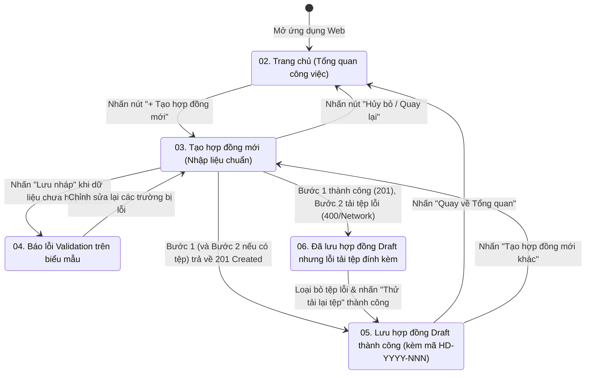

# Tài liệu Đặc tả Thiết kế Giao diện & Trải nghiệm Người dùng (UI/UX Specification)
## Hạng mục: PB-01 — Tạo và lưu hợp đồng mới ở trạng thái Draft (Sprint 01)

| Thuộc tính | Nội dung chi tiết |
| :--- | :--- |
| **Mã Product Backlog** | `PB-01` |
| **Thuộc Sprint** | `Sprint 01` |
| **Mã công việc (Task)** | `TASK-10` — Thiết kế Prototype & Đặc tả UI/UX Figma cho màn hình Tạo hợp đồng mới |
| **Liên kết GitHub Issues** | Issue `#1` (`PB-01`), Issue `#11` (`TASK-10`) |
| **Người thực hiện** | Trần Ngọc Long (`LONGTRAN2700`) — Thiết kế UI/UX & Lập trình Frontend |
| **Công nghệ áp dụng** | React + TypeScript + Vite + Tailwind CSS + shadcn/ui + lucide-react |

---

## 1. Hệ thống Quy chuẩn Thiết kế (Design System & Tokens)

Toàn bộ giao diện thuộc phân hệ Quản lý Hợp đồng được thiết kế đồng nhất theo chuẩn **Enterprise B2B Dashboard** dành cho Công ty ABC Logistics.

### 1.1. Bảng màu chuẩn (Color Palette)
| Nhóm màu | Tên Token | Mã màu Hex | Ứng dụng trên giao diện |
| :--- | :--- | :---: | :--- |
| **Thương hiệu & Hành động chính** | `Primary` | `#1D4ED8` | Nút hành động chính (`+ Tạo hợp đồng mới`, `Lưu nháp`, `Thử tải lại tệp`), trạng thái focus của ô nhập liệu. |
| **Khung điều hướng** | `Sidebar Background` | `#0F172A` | Thanh điều hướng dọc cố định bên trái (`240px`). |
| **Đầu trang & Bề mặt thẻ** | `Header / Surface` | `#FFFFFF` | Thanh tiêu đề trên cùng (`64px`), nền các khối Card thông tin và hộp thoại xác nhận. |
| **Nền tổng thể** | `Page Background` | `#F8FAFC` | Nền vùng làm việc chính phía sau các Card nội dung. |
| **Đường viền & Phân cách** | `Border` | `#E2E8F0` | Đường viền ô nhập liệu mặc định, đường kẻ ngăn cách Card và bảng dữ liệu. |
| **Ngữ nghĩa trạng thái** | `Success` | `#16A34A` | Biểu tượng & thông báo lưu hợp đồng nháp và tải tệp thành công. |
| | `Warning` | `#D97706` | Cảnh báo trạng thái lưu hợp đồng thành công nhưng tải tệp đính kèm bị lỗi (`Partial Failure`). |
| | `Danger / Error` | `#DC2626` | Viền ô nhập liệu lỗi, dấu sao bắt buộc (`*`), thông báo lỗi kiểm tra dữ liệu và tệp vượt quá `20 MB`. |
| | `Info` | `#0284C7` | Huy hiệu trạng thái `Draft` (Bản nháp) và ghi chú hướng dẫn định dạng tệp. |
| | `E-Sign Accent` | `#7C3AED` | Nhấn mạnh các thành phần liên quan đến quy trình ký số ở các giai đoạn tiếp theo. |

### 1.2. Kiểu chữ & Lưới bố cục (Typography & Spacing Grid)
- **Font chữ chuẩn**: `Inter` (`sans-serif`), hỗ trợ đầy đủ dấu tiếng Việt và hiển thị số liệu tài chính rõ nét (`tabular-nums`).
- **Hệ lưới khoảng cách**: Bội số của **`8px`** (`8px`, `16px`, `24px`, `32px`).
- **Kích thước khung App Shell**:
  - **Sidebar trái**: Rộng cố định `240px`, hiển thị logo **ABC Business**, danh mục các phân hệ và đánh dấu mục đang chọn **Quản lý hợp đồng**.
  - **Header trên cùng**: Cao cố định `64px`, hiển thị đường dẫn Breadcrumb, thông báo và thông tin phiên làm việc của Nhân viên Kinh doanh (`NV-KD-001 | Nguyễn Văn An`).
- **Kích thước thành phần biểu mẫu (Form Controls)**:
  - Ô nhập liệu (`Input`, `Select`) và nút bấm (`Button`): Chiều cao chuẩn `40px`, bo góc `8px`.
  - Khối thẻ (`Card`) và hộp thoại (`Modal/Banner`): Bo góc `12px`, đổ bóng nhẹ (`shadow-sm`).

---

## 2. Danh mục 6 Màn hình Thiết kế trong `docs/design/sprint-01/`

Các bản xuất thiết kế độ phân giải cao đã được lưu trữ trực tiếp trong cùng thư mục `docs/design/sprint-01/`:

| STT | Tên tệp thiết kế | Tên màn hình / Trạng thái giao diện | Mô tả chi tiết nội dung hiển thị |
| :---: | :--- | :--- | :--- |
| 01 | [`01_Quy_Chuan_Thiet_Ke_Design_System.png`](./01_Quy_Chuan_Thiet_Ke_Design_System.png) | **Quy chuẩn Thiết kế (Design System)** | Bảng quy định màu sắc, thang chữ `Inter`, kích thước nút bấm, ô nhập liệu, huy hiệu trạng thái và các thành phần `shadcn/ui`. |
| 02 | [`02_Trang_Chu_Tong_Quan_Cong_Viec.png`](./02_Trang_Chu_Tong_Quan_Cong_Viec.png) | **Trang chủ — Tổng quan công việc** | Màn hình mở đầu sau khi vào hệ thống: hiển thị thống kê nhanh, danh sách hợp đồng gần đây và nút CTA chính **`+ Tạo hợp đồng mới`** ở góc phải trên. |
| 03 | [`03_Tao_Hop_Dong_Moi_Trang_Thai_Nhap_Lieu.png`](./03_Tao_Hop_Dong_Moi_Trang_Thai_Nhap_Lieu.png) | **Tạo hợp đồng mới — Trạng thái nhập liệu chuẩn** | Biểu mẫu nhập thông tin hợp đồng chia 2 cột cân đối: Khối thông tin chung & khách hàng `Active`, khối thời hạn & giá trị hợp đồng (`VND`), điều khoản thương mại và vùng kéo thả tệp đính kèm (`PDF, DOCX, XLSX <= 20 MB`). |
| 04 | [`04_Tao_Hop_Dong_Moi_Trang_Thai_Bao_Loi.png`](./04_Tao_Hop_Dong_Moi_Trang_Thai_Bao_Loi.png) | **Tạo hợp đồng mới — Trạng thái báo lỗi Validation** | Minh họa trạng thái khi người dùng bỏ trống trường bắt buộc, nhập `effectiveFrom > effectiveTo`, `contractValue <= 0` hoặc chọn tệp sai định dạng/quá `20 MB`: các trường lỗi chuyển viền `#DC2626` kèm thông điệp tiếng Việt rõ ràng. |
| 05 | [`05_Tao_Hop_Dong_Moi_Luu_Draft_Thanh_Cong.png`](./05_Tao_Hop_Dong_Moi_Luu_Draft_Thanh_Cong.png) | **Tạo hợp đồng mới — Lưu Draft & tệp thành công** | Hiển thị thông báo thành công màu xanh lá (`#16A34A`), cấp mã hợp đồng tự động (ví dụ `HD-2026-001`), trạng thái `Draft`, danh sách tệp đính kèm đã tải lên và nút tạo hợp đồng tiếp theo hoặc quay về danh sách. |
| 06 | [`06_Tao_Hop_Dong_Moi_Loi_Tai_Tep_Dinh_Kem.png`](./06_Tao_Hop_Dong_Moi_Luu_Draft_Thanh_Cong.png) | **Tạo hợp đồng mới — Lỗi tải tệp đính kèm (Partial Failure)** | Trạng thái khi Bước 1 (`POST /api/contracts`) đã lưu thành công vào PostgreSQL với mã `HD-2026-001` nhưng Bước 2 (`POST /api/contracts/{id}/attachments`) thất bại: hiển thị Banner cảnh báo vàng/đỏ, giữ nguyên mã hợp đồng đã cấp, báo rõ tệp bị lỗi và cung cấp nút **"Thử tải lại tệp"**. |

---

## 3. Luồng Chuyển đổi Màn hình & Tương tác Người dùng (Screen Flow)

---

## 4. Đặc tả Chi tiết Các Thành phần Giao diện trên Màn hình Tạo Hợp đồng (`TASK-12`)

### 4.1. Khối Thông tin Định danh & Kiểm toán (Read-only Metadata)
- **Mã hợp đồng (`contractCode`)**: Hiển thị giá trị tạm `"Tự động cấp khi lưu (HD-2026-XXX)"` ở chế độ nhập liệu; ngay sau khi lưu Bước 1 thành công sẽ hiển thị mã thật từ Server trả về.
- **Trạng thái (`status`)**: Hiển thị cố định Badge **`Draft (Bản nháp)`**.
- **Người khởi tạo (`createdBy`)**: Hiển thị cố định **`NV-KD-001 | Nguyễn Văn An`** (Chỉ hiển thị trên UI để người dùng nắm ngữ cảnh, Frontend **không** gửi trường này trong request body lên Server theo đúng quy tắc `BR-06`).

### 4.2. Khối Chọn Khách hàng Đang Hoạt động (`Customer Selector`)
- Gọi API `GET /api/customers?activeOnly=true` ngay khi mở trang.
- Chỉ hiển thị các khách hàng có `status = 'Active'`.
- Khi người dùng chọn một khách hàng, giao diện hiển thị ngay thẻ tóm tắt thông tin đối tác bên dưới (Mã khách hàng `customerCode`, Mã số thuế `taxCode`, Người liên hệ `contactPerson`, Số điện thoại `contactPhone`, Địa chỉ `address`) để Nhân viên Kinh doanh kiểm tra chéo trước khi lưu.

### 4.3. Khối Vùng Kéo Thả Tệp Đính kèm & Cơ chế Phục hồi Lỗi (`Attachment Dropzone`)
- Cho phép chọn hoặc kéo thả nhiều tệp cùng lúc; hỗ trợ xóa từng tệp khỏi danh sách chờ trước khi lưu.
- Kiểm tra tức thời ở phía Client và đối chiếu kết quả từ Backend:
  - Chỉ cho phép các tệp `.pdf`, `.docx`, `.xlsx`.
  - Dung lượng mỗi tệp không vượt quá `20 MB`.
- **Trạng thái `Partial Failure` (Màn hình số 06)**:
  - Khi Bước 1 (`POST /api/contracts`) đã trả về `201 Created`, Frontend lưu giữ `createdContract` (chứa `id` và `contractCode`) vào state.
  - Nếu Bước 2 (`POST /api/contracts/{id}/attachments`) thất bại, toàn bộ các ô thông tin hợp đồng ở Bước 1 được chuyển sang trạng thái khóa (`disabled/readOnly`) để đảm bảo người dùng không vô tình tạo thêm bản ghi hợp đồng trùng lặp.
  - Nút hành động chính tự động đổi thành **"Thử tải lại tệp"** để chỉ gọi lại duy nhất API tải tệp cho `contractId` đã tạo.
