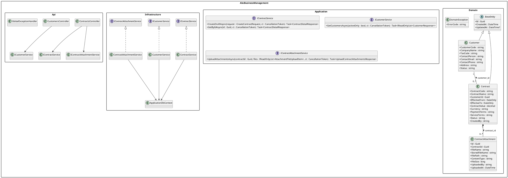
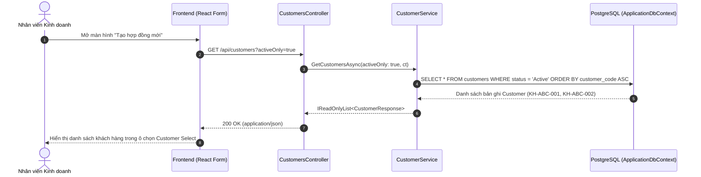
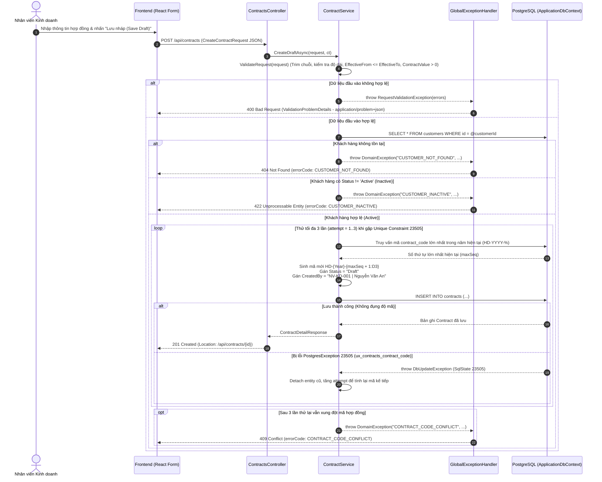
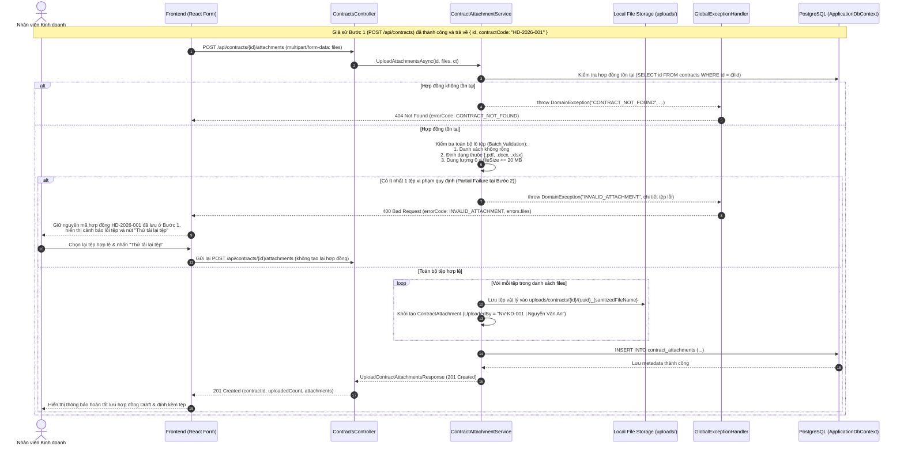
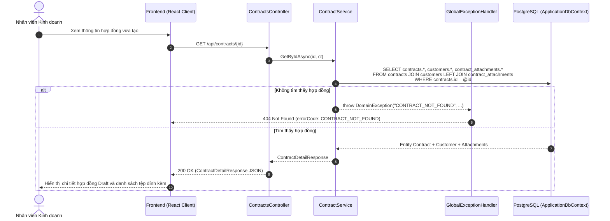

# Thiết kế Kỹ thuật UML: Sơ đồ Lớp (Class Diagram) & Sơ đồ Tuần tự (Sequence Diagram) — `PB-01`

| Thông tin tài liệu | Chi tiết |
| :--- | :--- |
| **Dự án** | Hệ thống Quản trị Kinh doanh — Công ty ABC (`ABC Business Management`) |
| **Sprint** | Sprint 01 |
| **Hạng mục (Product Backlog)** | `PB-01` — Tạo và lưu hợp đồng mới ở trạng thái `Draft` (Issue `#1`) |
| **Mã công việc** | `TASK-07` — Thiết kế UML Class Diagram & Sequence Diagram cho `PB-01` (Issue `#8`) |
| **Người thực hiện** | Thạch Ý (`ThachY-23120411`) |
| **Tài liệu tham chiếu** | [`PB-01-create-contract-spec.md`](../specs/PB-01-create-contract-spec.md), [`use-case-PB01.md`](./use-case-PB01.md) |
| **Phiên bản** | `v1.0` |

---

## 1. Tổng quan Kiến trúc Phân lớp (Layered Architecture)

Hệ thống Backend cho `PB-01` được tổ chức theo kiến trúc phân lớp chuẩn trên nền tảng **.NET 10 Web API** và **Entity Framework Core (PostgreSQL)**:

1. **`AbcBusinessManagement.Domain`**:
   - Chứa các thực thể cốt lõi (`BaseEntity`, `Customer`, `Contract`, `ContractAttachment`), hằng số nghiệp vụ (`AuditConstants`) và ngoại lệ miền (`DomainException`).
   - Không phụ thuộc vào bất kỳ thư viện hạ tầng hay framework giao tiếp nào.
2. **`AbcBusinessManagement.Application`**:
   - Chứa các hợp đồng dịch vụ (`IContractService`, `ICustomerService`, `IContractAttachmentService`), các đối tượng truyền tải dữ liệu (`CreateContractRequest`, `ContractDetailResponse`, `ContractAttachmentResponse`, `UploadContractAttachmentsResponse`, `CustomerResponse`) và ngoại lệ kiểm tra đầu vào (`RequestValidationException`).
3. **`AbcBusinessManagement.Infrastructure`**:
   - Hiện thực hóa truy cập dữ liệu qua `ApplicationDbContext`, các cấu hình Fluent API (`CustomerConfiguration`, `ContractConfiguration`, `ContractAttachmentConfiguration`), dữ liệu khởi tạo (`CustomerSeedData`) và các lớp xử lý nghiệp vụ (`ContractService`, `CustomerService`, `ContractAttachmentService`).
4. **`AbcBusinessManagement.Api`**:
   - Cung cấp các RESTful Controllers (`ContractsController`, `CustomersController`), bộ xử lý ngoại lệ tập trung chuẩn RFC 7807 (`GlobalExceptionHandler`, `ProblemResponse`) và middleware ghi nhận nhật ký truy cập (`RequestLoggingMiddleware`).

---

## 2. Sơ đồ Lớp (UML Class Diagram — `PB-01`)

### 2.1. Biểu diễn bằng Mermaid (`classDiagram`)

```mermaid
classDiagram
    direction TB

    class BaseEntity {
        <<abstract>>
        +Guid Id
        +DateTime CreatedAt
        +DateTime? UpdatedAt
    }

    class Customer {
        +string CustomerCode
        +string CompanyName
        +string TaxCode
        +string ContactPerson
        +string ContactEmail
        +string ContactPhone
        +string Address
        +string Status
        +ICollection~Contract~ Contracts
    }

    class Contract {
        +string ContractCode
        +string ContractName
        +Guid CustomerId
        +DateOnly EffectiveFrom
        +DateOnly EffectiveTo
        +decimal ContractValue
        +string Currency
        +string PaymentTerms
        +string ServiceTerms
        +string Status
        +string CreatedBy
        +Customer Customer
        +ICollection~ContractAttachment~ Attachments
    }

    class ContractAttachment {
        +Guid Id
        +Guid ContractId
        +string FileName
        +string StoredFileName
        +string FilePath
        +string ContentType
        +long FileSize
        +string UploadedBy
        +DateTime UploadedAt
        +Contract Contract
    }

    class AuditConstants {
        <<static>>
        +string DefaultActor = "NV-KD-001 | Nguyễn Văn An"
        +string DefaultCurrency = "VND"
        +string DraftStatus = "Draft"
        +string ActiveCustomerStatus = "Active"
        +int MaxContractCodeRetries = 3
        +long MaxAttachmentSizeBytes = 20971520
    }

    class DomainException {
        +string ErrorCode
        +DomainException(string errorCode, string message)
    }

    class RequestValidationException {
        +IDictionary~string, string[]~ Errors
        +RequestValidationException(IDictionary~string, string[]~ errors)
    }

    class CreateContractRequest {
        +string ContractName
        +Guid CustomerId
        +DateOnly EffectiveFrom
        +DateOnly EffectiveTo
        +decimal ContractValue
        +string? Currency
        +string PaymentTerms
        +string ServiceTerms
    }

    class ContractDetailResponse {
        +Guid Id
        +string ContractCode
        +string ContractName
        +Guid CustomerId
        +string CustomerCode
        +string CustomerName
        +DateOnly EffectiveFrom
        +DateOnly EffectiveTo
        +decimal ContractValue
        +string Currency
        +string PaymentTerms
        +string ServiceTerms
        +string Status
        +string CreatedBy
        +DateTime CreatedAt
        +DateTime? UpdatedAt
        +IReadOnlyList~ContractAttachmentResponse~ Attachments
    }

    class ContractAttachmentResponse {
        +Guid Id
        +Guid ContractId
        +string FileName
        +string ContentType
        +long FileSize
        +string UploadedBy
        +DateTime UploadedAt
    }

    class UploadContractAttachmentsResponse {
        +Guid ContractId
        +int UploadedCount
        +IReadOnlyList~ContractAttachmentResponse~ Attachments
    }

    class CustomerResponse {
        +Guid Id
        +string CustomerCode
        +string CompanyName
        +string TaxCode
        +string ContactPerson
        +string ContactEmail
        +string ContactPhone
        +string Address
        +string Status
    }

    class IContractService {
        <<interface>>
        +CreateDraftAsync(CreateContractRequest request, CancellationToken ct) Task~ContractDetailResponse~
        +GetByIdAsync(Guid id, CancellationToken ct) Task~ContractDetailResponse~
    }

    class ICustomerService {
        <<interface>>
        +GetCustomersAsync(bool activeOnly, CancellationToken ct) Task~IReadOnlyList~CustomerResponse~~
    }

    class IContractAttachmentService {
        <<interface>>
        +UploadAttachmentsAsync(Guid contractId, IReadOnlyList~AttachmentFileUploadItem~ files, CancellationToken ct) Task~UploadContractAttachmentsResponse~
    }

    class ApplicationDbContext {
        +DbSet~Customer~ Customers
        +DbSet~Contract~ Contracts
        +DbSet~ContractAttachment~ ContractAttachments
    }

    class ContractService {
        -ApplicationDbContext _dbContext
        -ILogger~ContractService~ _logger
        +CreateDraftAsync(CreateContractRequest request, CancellationToken ct) Task~ContractDetailResponse~
        +GetByIdAsync(Guid id, CancellationToken ct) Task~ContractDetailResponse~
        -ValidateRequest(CreateContractRequest request) void
        -GenerateNextContractCodeAsync(int year, CancellationToken ct) Task~string~
    }

    class CustomerService {
        -ApplicationDbContext _dbContext
        +GetCustomersAsync(bool activeOnly, CancellationToken ct) Task~IReadOnlyList~CustomerResponse~~
    }

    class ContractAttachmentService {
        -ApplicationDbContext _dbContext
        -ILogger~ContractAttachmentService~ _logger
        +UploadAttachmentsAsync(Guid contractId, IReadOnlyList~AttachmentFileUploadItem~ files, CancellationToken ct) Task~UploadContractAttachmentsResponse~
    }

    class ContractsController {
        -IContractService _contractService
        -IContractAttachmentService _attachmentService
        +CreateDraft(CreateContractRequest request, CancellationToken ct) Task~IActionResult~
        +GetById(Guid id, CancellationToken ct) Task~IActionResult~
        +UploadAttachments(Guid id, List~IFormFile~ files, CancellationToken ct) Task~IActionResult~
    }

    class CustomersController {
        -ICustomerService _customerService
        +GetCustomers(bool activeOnly, CancellationToken ct) Task~IActionResult~
    }

    class GlobalExceptionHandler {
        +TryHandleAsync(HttpContext context, Exception exception, CancellationToken ct) ValueTask~bool~
    }

    BaseEntity <|-- Customer
    BaseEntity <|-- Contract
    Customer "1" --> "0..*" Contract : đứng tên (customer_id)
    Contract "1" *-- "0..*" ContractAttachment : đính kèm (contract_id)

    IContractService <|.. ContractService
    ICustomerService <|.. CustomerService
    IContractAttachmentService <|.. ContractAttachmentService

    ContractService --> ApplicationDbContext
    ContractService --> AuditConstants
    ContractService ..> DomainException
    ContractService ..> RequestValidationException

    CustomerService --> ApplicationDbContext
    ContractAttachmentService --> ApplicationDbContext
    ContractAttachmentService --> AuditConstants
    ContractAttachmentService ..> DomainException

    ContractsController --> IContractService
    ContractsController --> IContractAttachmentService
    CustomersController --> ICustomerService
    GlobalExceptionHandler ..> DomainException
    GlobalExceptionHandler ..> RequestValidationException
```

### 2.2. Mã nguồn PlantUML tương đương

---

## 3. Đặc tả Trách nhiệm các Lớp Cốt lõi

| Lớp / Interface | Tầng (Layer) | Trách nhiệm kỹ thuật chi tiết |
| :--- | :--- | :--- |
| `Customer`, `Contract`, `ContractAttachment` | `Domain` | Mô hình hóa dữ liệu bảng `customers`, `contracts`, `contract_attachments` trong PostgreSQL. |
| `AuditConstants` | `Domain` | Định nghĩa hằng số danh tính kiểm toán cố định `"NV-KD-001 \| Nguyễn Văn An"`, trạng thái `"Draft"`, tiền tệ `"VND"` và giới hạn dung lượng tệp `20 MB` (`20,971,520 bytes`). |
| `IContractService` / `ContractService` | `Application` / `Infrastructure` | Kiểm tra hợp lệ dữ liệu hợp đồng (`BR-02`, `BR-03`, `BR-06`), sinh mã `HD-YYYY-NNN` kèm cơ chế thử lại tối đa 3 lần khi gặp lỗi `Unique Constraint` (`SqlState 23505` trên `ux_contracts_contract_code`), lưu hợp đồng `Draft` và truy vấn chi tiết hợp đồng kèm tệp đính kèm. |
| `ICustomerService` / `CustomerService` | `Application` / `Infrastructure` | Truy vấn danh sách khách hàng (`activeOnly = true` mặc định chỉ lấy `Status == "Active"`), sắp xếp tăng dần theo `CustomerCode`. |
| `IContractAttachmentService` / `ContractAttachmentService` | `Application` / `Infrastructure` | Kiểm tra sự tồn tại của hợp đồng, xác thực toàn bộ lô tệp đính kèm (`.pdf`, `.docx`, `.xlsx`, dung lượng `<= 20 MB/tệp`), lưu tệp vật lý với tên duy nhất `{uuid}_{fileName}` và ghi nhận metadata vào bảng `contract_attachments`. |
| `ContractsController`, `CustomersController` | `Api` | Tiếp nhận HTTP Request, điều phối xuống tầng Application Service và trả về HTTP Status Code chuẩn (`200 OK`, `201 Created` kèm header `Location`). |
| `GlobalExceptionHandler` | `Api` | Bắt `RequestValidationException`, `DomainException` và các lỗi hệ thống để chuẩn hóa phản hồi theo RFC 7807 (`application/problem+json`) kèm `traceId` và `errorCode`. |

---

## 4. Sơ đồ Tuần tự (UML Sequence Diagrams — `PB-01`)

### 4.1. `SD-01`: Lấy danh sách Khách hàng đang hoạt động (`GET /api/customers?activeOnly=true`)

---

### 4.2. `SD-02`: Tạo mới Hợp đồng `Draft` và Chống đụng độ Mã hợp đồng (`POST /api/contracts`)

Sơ đồ dưới đây mô tả chi tiết luồng kiểm tra nghiệp vụ, tự động gán `CreatedBy = "NV-KD-001 | Nguyễn Văn An"`, sinh mã `HD-YYYY-NNN` và cơ chế **Retry tối đa 3 lần** khi nhiều request đồng thời đụng độ khóa duy nhất `ux_contracts_contract_code` (`PostgresException 23505`).

---

### 4.3. `SD-03`: Quy trình Lưu 2 Bước & Tải tệp đính kèm (`POST /api/contracts/{id}/attachments`)

Sơ đồ mô tả Bước 2 của quy trình lưu 2 bước, bao gồm cả kịch bản thành công toàn phần và kịch bản **Lỗi từng phần (Partial Failure)** khi tệp đính kèm không hợp lệ nhưng hợp đồng `Draft` ở Bước 1 vẫn được bảo toàn trong PostgreSQL.

---

### 4.4. `SD-04`: Xem chi tiết Hợp đồng kèm danh sách Tệp đính kèm (`GET /api/contracts/{id}`)

