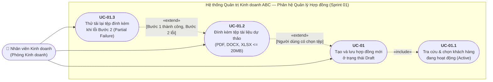
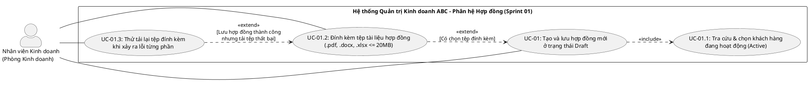

# Mô hình hóa Use Case UML & Đặc tả Kịch bản Nghiệp vụ
## Hạng mục: PB-01 - Tạo và lưu hợp đồng mới ở trạng thái Draft

| Thuộc tính | Nội dung chi tiết |
| :--- | :--- |
| **Mã Product Backlog** | `PB-01` |
| **Thuộc Sprint** | `Sprint 01` |
| **Mã công việc (Task)** | `TASK-03` - Thiết kế sơ đồ Use Case UML và đặc tả luồng sự kiện cho PB-01 |
| **Liên kết GitHub Issues** | Issue `#1` (`PB-01`), Issue `#4` (`TASK-03`) |
| **Người thực hiện** | Nguyễn Khả Như (`KN12345N`) — Phân tích nghiệp vụ (BA) |
| **Tài liệu tham chiếu** | `docs/specs/PB-01-create-contract-spec.md` (`TASK-02`) |

---

## 1. Xác định Tác nhân (Actors) và Phạm vi Hệ thống

### 1.1. Danh sách Tác nhân
| STT | Tên tác nhân | Phân loại | Mô tả vai trò trong phạm vi `PB-01` |
| :---: | :--- | :--- | :--- |
| 1 | **Nhân viên Kinh doanh** (`Sales Executive`) | Tác nhân chính (Primary Actor) | Nhân sự thuộc Phòng Kinh doanh Công ty ABC Logistics, trực tiếp khởi tạo hồ sơ hợp đồng dịch vụ mới cho khách hàng doanh nghiệp, nhập điều khoản thương mại và đính kèm các tài liệu dự thảo liên quan. |
| 2 | **Hệ thống Quản lý Hợp đồng ABC** (`ABC Contract System`) | Hệ thống đích (System under Discussion) | Thực hiện kiểm tra ràng buộc nghiệp vụ, tự động cấp mã hợp đồng duy nhất (`HD-YYYY-NNN`), gán định danh kiểm toán (`NV-KD-001 \| Nguyễn Văn An`) và lưu trữ dữ liệu bền vững vào PostgreSQL. |

### 1.2. Danh sách Use Case trong phạm vi `PB-01`
| Mã Use Case | Tên Use Case | Quan hệ UML | Liên kết Tiêu chí Chấp nhận (`AC`) |
| :--- | :--- | :--- | :--- |
| **UC-01** | Tạo và lưu hợp đồng mới ở trạng thái `Draft` | Use Case trung tâm | `AC-02`, `AC-03`, `AC-04`, `AC-05`, `AC-06` |
| **UC-01.1** | Tra cứu và chọn khách hàng đang hoạt động (`Active`) | `<<include>>` từ `UC-01` | `AC-01`, `AC-03` |
| **UC-01.2** | Đính kèm tệp tài liệu hợp đồng (`.pdf`, `.docx`, `.xlsx`) | `<<extend>>` vào `UC-01` | `AC-06`, `AC-07`, `AC-08` |
| **UC-01.3** | Thử tải lại tệp đính kèm khi xảy ra lỗi từng phần (`Partial Failure`) | `<<extend>>` vào `UC-01.2` | `AC-08` |

---

## 2. Sơ đồ Use Case Tổng thể (`PB-01`)

### 2.1. Biểu diễn trực quan (Mermaid Flowchart theo chuẩn ký hiệu Use Case)



### 2.2. Mã nguồn PlantUML chuẩn (`docs/uml/use-case-PB01.puml` tích hợp)



---

## 3. Đặc tả Chi tiết Các Use Case

### 3.1. Đặc tả `UC-01`: Tạo và lưu hợp đồng mới ở trạng thái `Draft`

| Mục đặc tả | Nội dung chi tiết |
| :--- | :--- |
| **Mã & Tên Use Case** | `UC-01` - Tạo và lưu hợp đồng mới ở trạng thái `Draft` |
| **Tác nhân chính** | Nhân viên Kinh doanh (`NV-KD-001 \| Nguyễn Văn An`) |
| **Mục đích** | Khởi tạo hồ sơ hợp đồng dịch vụ logistics mới cho khách hàng đang hoạt động, cấp mã `contractCode` duy nhất và lưu ở trạng thái `Draft`. |
| **Điều kiện tiên quyết (Preconditions)** | 1. Cơ sở dữ liệu PostgreSQL đang hoạt động và đã có dữ liệu danh mục khách hàng. <br>2. Nhân viên Kinh doanh đang truy cập màn hình **Trang chủ (Tổng quan công việc)** hoặc **Tạo hợp đồng mới**. |
| **Sự kiện kích hoạt (Trigger)** | Nhân viên Kinh doanh nhấn nút **"+ Tạo hợp đồng mới"** trên màn hình Tổng quan công việc. |
| **Kết quả sau thực hiện (Postconditions)** | - **Thành công**: Bản ghi hợp đồng mới được lưu vào bảng `contracts` với `status = 'Draft'`, `contractCode` định dạng `HD-YYYY-NNN`, `createdBy = 'NV-KD-001 \| Nguyễn Văn An'` và `createdAt` (UTC). <br>- **Thất bại**: Không có bản ghi hợp đồng không hợp lệ nào được ghi vào CSDL; hệ thống hiển thị thông báo lỗi cụ thể trên giao diện. |

#### Luồng sự kiện chính (Main Success Scenario - Không đính kèm tệp)
1. Nhân viên Kinh doanh nhấn nút **"+ Tạo hợp đồng mới"**.
2. Hệ thống mở màn hình **Tạo hợp đồng mới**, hiển thị các trường mặc định (`Trạng thái: Draft`, `Đơn vị tiền tệ: VND`, `Người tạo: NV-KD-001 | Nguyễn Văn An`) và tự động thực thi `UC-01.1` để nạp danh sách khách hàng có trạng thái `Active` (`GET /api/customers?activeOnly=true`).
3. Nhân viên Kinh doanh chọn một khách hàng đang hoạt động từ danh sách.
4. Nhân viên Kinh doanh nhập đầy đủ các thông tin bắt buộc:
   - Tên hợp đồng (`contractName`: 5–255 ký tự)
   - Ngày bắt đầu hiệu lực (`effectiveFrom`) và Ngày kết thúc hiệu lực (`effectiveTo`, đảm bảo `effectiveFrom <= effectiveTo`)
   - Giá trị hợp đồng (`contractValue > 0`)
   - Điều khoản thanh toán (`paymentTerms`: 10–4000 ký tự)
   - Điều khoản dịch vụ (`serviceTerms`: 10–4000 ký tự)
5. Nhân viên Kinh doanh để trống vùng tệp đính kèm và nhấn nút **"Lưu nháp"**.
6. Hệ thống kiểm tra tính hợp lệ dữ liệu ở phía Client (React Hook Form + Zod) và gửi yêu cầu `POST /api/contracts` lên Backend.
7. Backend kiểm tra lại toàn bộ quy tắc nghiệp vụ (`BR-01` đến `BR-06`), xác nhận khách hàng có tồn tại và có `status = 'Active'`.
8. Backend tự động sinh mã hợp đồng `contractCode` duy nhất theo mẫu `HD-YYYY-NNN` (có cơ chế retry tối đa 3 lần nếu xảy ra đụng độ `Unique Constraint` khi có nhiều yêu cầu đồng thời).
9. Backend gán cứng `status = 'Draft'`, `createdBy = 'NV-KD-001 | Nguyễn Văn An'`, `createdAt = UtcNow` và lưu bản ghi vào bảng `contracts` trong PostgreSQL.
10. Backend trả về phản hồi `201 Created` kèm thông tin chi tiết hợp đồng vừa tạo.
11. Giao diện hiển thị hộp thoại/thông báo xác nhận **"Lưu hợp đồng nháp thành công"** kèm mã hợp đồng `contractCode` vừa cấp. Kết thúc Use Case.

#### Luồng mở rộng (Extension Flows)
- **5a. Nhân viên Kinh doanh có chọn một hoặc nhiều tệp đính kèm trước khi nhấn "Lưu nháp"**:
  - `5a.1.` Sau khi hoàn tất Bước 10 (`POST /api/contracts` trả về `201 Created` kèm `contractId`), hệ thống kích hoạt Use Case mở rộng **`UC-01.2`** để tải danh sách tệp lên `POST /api/contracts/{id}/attachments`.

#### Luồng ngoại lệ (Exception Flows)
- **6a. Dữ liệu nhập trên biểu mẫu không hợp lệ (thiếu trường bắt buộc, `effectiveFrom > effectiveTo`, `contractValue <= 0`)**:
  - `6a.1.` Hệ thống chặn gửi request (nếu phát hiện ở Client) hoặc trả về `400 Bad Request` theo chuẩn `ValidationProblemDetails` (nếu kiểm tra ở Server).
  - `6a.2.` Giao diện tô viền đỏ (`#DC2626`) tại các ô bị lỗi và hiển thị thông điệp hướng dẫn ngay bên dưới từng trường. Người dùng chỉnh sửa và quay lại Bước 4.
- **7a. Khách hàng không tồn tại (`404 Not Found`) hoặc đã ngưng hoạt động (`422 Unprocessable Entity` - `CUSTOMER_INACTIVE`)**:
  - `7a.1.` Backend từ chối tạo hợp đồng và trả về đối tượng `ProblemDetails` kèm mã lỗi tương ứng.
  - `7a.2.` Giao diện hiển thị cảnh báo lỗi để Nhân viên Kinh doanh chọn lại khách hàng khác đang hoạt động.
- **8a. Xung đột sinh mã hợp đồng vượt quá 3 lần thử lại liên tiếp (`409 Conflict` - `CONTRACT_CODE_CONFLICT`)**:
  - `8a.1.` Backend trả về mã `409 Conflict` theo chuẩn `ProblemDetails` (không phát sinh lỗi `500`).
  - `8a.2.` Giao diện thông báo hệ thống đang xử lý nhiều yêu cầu đồng thời và cho phép người dùng nhấn **"Lưu nháp"** lại.

---

### 3.2. Đặc tả `UC-01.1`: Tra cứu và chọn khách hàng đang hoạt động (`Active`)

| Mục đặc tả | Nội dung chi tiết |
| :--- | :--- |
| **Mã & Tên Use Case** | `UC-01.1` - Tra cứu và chọn khách hàng đang hoạt động (`Active`) |
| **Quan hệ** | Được bao gồm (`<<include>>`) trong `UC-01` |
| **Luồng xử lý** | 1. Khi khởi tạo màn hình Tạo hợp đồng mới, Frontend gọi `GET /api/customers?activeOnly=true`. <br>2. Backend truy vấn bảng `customers` lọc theo điều kiện `status = 'Active'` và sắp xếp theo `customer_code` tăng dần. <br>3. Giao diện hiển thị danh sách khách hàng kèm mã khách hàng, tên công ty và mã số thuế (ví dụ: `KH-ABC-001 — Công ty Cổ phần Chuỗi Cung Ứng Á Châu`). <br>4. Khi người dùng chọn một khách hàng, hệ thống tự động điền thông tin tham chiếu (Mã số thuế, Người liên hệ, Địa chỉ) lên vùng thông tin đối tác trên màn hình để tiện đối chiếu. |

---

### 3.3. Đặc tả `UC-01.2` & `UC-01.3`: Đính kèm tệp tài liệu & Xử lý lỗi từng phần (`Partial Failure`)

| Mục đặc tả | Nội dung chi tiết |
| :--- | :--- |
| **Mã & Tên Use Case** | `UC-01.2` - Đính kèm tệp tài liệu hợp đồng & `UC-01.3` - Thử tải lại tệp đính kèm |
| **Điểm mở rộng (Extension Point)** | Kích hoạt ngay sau khi Bước 1 (`POST /api/contracts`) trả về `201 Created` và danh sách tệp người dùng chọn có số lượng `>= 1`. |
| **Quy tắc kiểm tra tệp (`BR-05`)** | - Định dạng hợp lệ: `.pdf`, `.docx`, `.xlsx` (không phân biệt chữ hoa/thường). <br>- Dung lượng mỗi tệp: `0 < fileSize <= 20 MB` (`20,971,520 bytes`). |
| **Luồng thành công (`UC-01.2`)** | 1. Frontend đóng gói danh sách tệp vào `FormData` (`files`) và gọi `POST /api/contracts/{contractId}/attachments`. <br>2. Backend kiểm tra toàn bộ các tệp trong lô tải lên. <br>3. Backend lưu tệp vật lý vào thư mục `uploads/contracts/{contractId}/`, ghi metadata vào bảng `contract_attachments` với `uploadedBy = 'NV-KD-001 \| Nguyễn Văn An'` và trả về `201 Created`. <br>4. Giao diện hiển thị trạng thái hoàn tất lưu cả hợp đồng `Draft` và danh sách tệp đính kèm. |
| **Luồng xử lý lỗi từng phần (`UC-01.3` - Partial Failure)** | 1. Nếu `POST /api/contracts/{contractId}/attachments` trả về lỗi (`400 Bad Request` do tệp sai định dạng/quá `20 MB` hoặc lỗi kết nối): <br>2. Bản ghi hợp đồng `Draft` đã tạo ở Bước 1 **vẫn tồn tại nguyên vẹn trong PostgreSQL** với mã `contractCode` đã cấp. <br>3. Giao diện chuyển sang trạng thái cảnh báo (`Warning/Error Banner`): hiển thị rõ mã hợp đồng đã tạo (ví dụ `HD-2026-001`), khóa các trường thông tin hợp đồng đã lưu để tránh tạo trùng hợp đồng mới, và liệt kê cụ thể tệp nào bị lỗi. <br>4. Người dùng xóa tệp không hợp lệ hoặc chọn tệp thay thế rồi nhấn nút **"Thử tải lại tệp"**. <br>5. Frontend **chỉ gọi lại riêng Bước 2** (`POST /api/contracts/{contractId}/attachments`) với `contractId` đã có cho đến khi thành công. |

---

## 4. Sơ đồ Hoạt động (Activity Diagram) - Quy trình Lưu 2 Bước

```mermaid
flowchart TD
    Start([Bắt đầu: Mở màn hình Tạo hợp đồng mới]) --> LoadCust[Gọi GET /api/customers?activeOnly=true]
    LoadCust --> FillForm[Nhập thông tin hợp đồng & chọn tệp đính kèm nếu có]
    FillForm --> ClickSave[Nhấn nút 'Lưu nháp']
    ClickSave --> ValidateClient{Kiểm tra dữ liệu<br/>trên Form hợp lệ?}
    ValidateClient -- Không --> ShowFormErr[Hiển thị lỗi validation màu đỏ dưới từng trường]
    ShowFormErr --> FillForm

    ValidateClient -- Có --> Step1[Bước 1: Gọi POST /api/contracts]
    Step1 --> Step1Ok{Bước 1 trả về<br/>201 Created?}
    Step1Ok -- Không (400/404/409/422) --> ShowApiErr[Hiển thị lỗi ProblemDetails từ Server]
    ShowApiErr --> FillForm

    Step1Ok -- Có (Nhận id & contractCode) --> HasFiles{Người dùng có chọn<br/>tệp đính kèm?}
    HasFiles -- Không --> SuccessAll([Hoàn tất: Hiển thị mã hợp đồng HD-YYYY-NNN])

    HasFiles -- Có --> Step2[Bước 2: Gọi POST /api/contracts/{id}/attachments]
    Step2 --> Step2Ok{Bước 2 trả về<br/>201 Created?}
    Step2Ok -- Có --> SuccessAll
    Step2Ok -- Không (Partial Failure) --> PartialState[Giữ nguyên hợp đồng Draft đã lưu trong DB;<br/>Hiển thị mã HD-YYYY-NNN & lý do lỗi tệp]
    PartialState --> AdjustFiles[Người dùng bỏ tệp lỗi / chọn lại tệp hợp lệ]
    AdjustFiles --> ClickRetry[Nhấn nút 'Thử tải lại tệp']
    ClickRetry --> Step2
```
